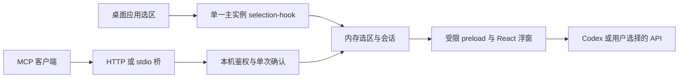

# 架构与数据流

Selection Desk 使用 Electron 主进程、受限 preload 桥和 React renderer。主进程负责桌面生命周期、原生取词、会话、模型来源、系统存储和本机 MCP 服务；renderer 负责显示与用户动作。共享动作和状态类型位于 `src/shared/types.ts`。

## 状态规则

普通选区的共享时效为 60 秒，来源标识和捕获时间与文本一起保存在内存。固定会话不被新选区覆盖；新选区作为待处理内容。浮窗展示不自动抢焦点，用户输入问题才激活输入。

首次启动打开设置；保存后常规启动驻留托盘，`--settings` 显式打开设置，`--background` 支持后台启动。关闭浮窗时销毁 renderer，后续展示时重新创建。GPU 加速已关闭；实际内存与 CPU 基线仍需持续测量。

翻译与问答走同一会话路径，响应增量更新 UI。默认 Codex；API 来源必须由用户主动选择，不进行隐式切换。停止和重试需保持会话状态一致。WorkBuddy 与千问办公反向对话尚未实现。

## 权限与持久化

MCP 核心仅监听 `127.0.0.1:18765`，端点为 `/mcp`。客户端使用独立 token，读取原文还需本次用户确认。stdio 是连接主实例的桥，不另装取词钩子。令牌配置确定请求方名称。

安装版的 stdio 导出以桌面可执行文件为 command，以 `resources/app.asar/dist/bridge/cli.cjs` 的绝对路径为参数，设置 `ELECTRON_RUN_AS_NODE=1` 和 `SELECTION_DESK_TOKEN`。桥接运行于 Electron 自带的 Node，不启动第二个浏览器窗口。单文件 portable 版只支持 HTTP。两种导出都包含客户端可读的凭据，系统加密存储不覆盖导出后的配置文件。

API 密钥和客户端 token 使用 Electron safeStorage；一般设置持久化，选区与会话正文不主动持久化。模型提供方和获得用户批准的 MCP 客户端各自控制收到的数据。Windows 同一用户下软件之间不具有由 safeStorage 保证的隔离，见 [官方说明](https://www.electronjs.org/docs/latest/api/safe-storage)。

自动剪贴板兜底默认关闭，待原生剪贴板格式恢复兼容性验证后评估启用。手动复制后可用 `Ctrl+Shift+Space` 读取。无遥测、无默认开机自启，不提供 OCR、语音、云同步或原文替换。

## 构建与发布

TypeScript/React 构建输出位于 `dist/`；electron-builder 生成 Windows x64 NSIS 与 portable 产物至 `release/`。NSIS 使用可选择安装目录的当前用户安装方式，配置参考 [electron-builder NSIS 文档](https://www.electron.build/nsis/)。测试版未签名。CI 检查 PR 并保存临时构建产物；main 新版本全部检查通过后发布为 prerelease，仅发布作业持有 contents:write 权限。已有同版本发布不覆盖。

模块自动检查不能替代原生桌面验收。门槛和证据统一记录在 [validation.md](validation.md)。
